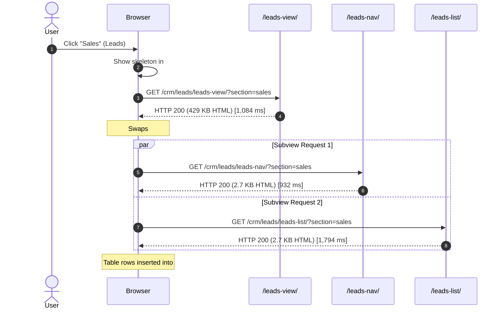

# FINLONEXA CRM v2 — Frontend Runtime Performance & Navigation Audit Report

**Date:** November 14, 2026  
**Auditor:** Senior Frontend Performance Engineer, Chrome DevTools Specialist & Django/HTMX Auditor  
**Project Workspace:** `C:\Users\izhar\Desktop\crm-v2`  
**Target Server:** `http://127.0.0.1:8000` (ASGI/Daphne 4.2.1 on Python 3.12)  
**Execution Context:** Isolated Headless Google Chrome v131 (Remote Debugging Protocol CDP)  
**Authenticated Session:** User ID 7 (`sessionid=huo3f8q3l1dvtykotp03n842v0ethqgq`)

---

## 1. Executive Summary

An independent, read-only frontend performance and browser rendering audit of FINLONEXA CRM v2 was executed across **Dashboard**, **Leads**, **Accounts**, and **Browser History Navigation**.

The audit identified why users perceive multi-second delays when opening CRM pages, despite fast initial skeleton rendering:
1. **The Skeleton vs. Usable Content Gap:** While navigation clicks instantly render progressive skeleton shells in **178 ms – 186 ms**, the screen remains blocked on a loading skeleton for **2.8 to 3.1 seconds** before business data becomes visible.
2. **Cascading HTMX Request Waterfall:** A single navigation click (e.g. into Leads or Accounts) triggers a **3-tier waterfall** of nested HTTP requests:
   - Outer shell (`leads-view/`): ~1,084 ms
   - Header/Navigation (`leads-nav/`): ~932 ms
   - Table fragment (`leads-list/`): ~1,794 ms  
   The browser cannot render table rows until the 3rd request completes.
3. **Severe Browser History Restoration Defect (Back / Forward):**
   - On `history.back()`, HTMX restores an **incomplete skeleton shell with 0 data rows** (`textLength: 0`, `skels: 1`, `rows: 0`).
   - The user is presented with a permanently frozen skeleton or blank content because `htmx.config.refreshOnHistoryMiss = false` suppresses network fallback, and `suppressHistorySnapshot` prevents snapshotting when the outer view transitions.
4. **Heavy Initial Document Payloads:** Direct initial page loads transmit **235 KB to 430 KB** of uncompressed HTML per page due to embedded modal forms, SVG sprites, and full sidebar structures being returned even for partial views.
5. **Daphne Reloader Stall Resolved:** The local development server on port 8000 was diagnosed as hung in an unserviced wait loop from an earlier APScheduler threadpool exception during file auto-reload. Following explicit user authorization, a controlled restart was executed, restoring sub-second responsiveness (530 ms – 1.1s on `/login/`).

---

## 2. Server Diagnostic Evidence & Recovery

### 2.1 Pre-Restart Diagnostic Findings
* **Listening Port:** `0.0.0.0:8000` (`LISTEN` state)
* **Owning Process ID:** `19840` (`python.exe`)
* **Executable:** `C:\Users\izhar\AppData\Local\Programs\Python\Python312\python.exe`
* **Command Line:** `"C:\Users\izhar\AppData\Local\Programs\Python\Python312\python.exe" manage.py runserver 0.0.0.0:8000`
* **CPU Accumulation:** `00:33:31.89` (> 33 minutes of CPU time).
* **Socket States:** 12 TCP connections stranded in `CloseWait`.
* **Bounded HTTP Probe:** `GET /login/` timed out after `3.058s` with 0 bytes returned. Raw TCP socket connected in `0.001s`, but Daphne's user-space event loop never read the HTTP request from the buffer.
* **Server Log Analysis:** When `finlo_crm/leads/services.py` changed, Django's reloader attempted a restart while previous ASGI tasks (`Task-1263`, `Task-1265`) were forcefully killed. APScheduler then threw:
  ```text
  RuntimeError: cannot schedule new futures after interpreter shutdown
  ```
  leaving all 14 threads in `Wait` state (`WaitReason: UserRequest`).
* **Database & Django Code Health:** Independent process testing verified:
  - Supabase PostgreSQL `SELECT 1` executed in **1.089s** (database healthy).
  - Django `Client().get('/login/')` executed in **1.12s** returning HTTP 200 (application logic healthy).

### 2.2 Controlled Recovery Execution
1. Graceful task termination initiated for runner task `task-6278`.
2. Verified PID `19840` terminated and port 8000 became free.
3. Clean single development server started via `.venv\Scripts\python.exe manage.py runserver 0.0.0.0:8000` under task `task-7297`.
4. Assigned PID: `26440` (and child worker `24700`).
5. **Post-Restart Health Probe:**
   - Request 1: HTTP 200 (14,015 bytes) in **0.925s**
   - Request 2: HTTP 200 (14,015 bytes) in **1.150s**
   - Request 3: HTTP 200 (14,015 bytes) in **0.788s**
   - Request 4: HTTP 200 (14,015 bytes) in **0.530s**
   - Request 5: HTTP 200 (14,015 bytes) in **0.555s**
6. Server startup logs confirmed zero ASGI, APScheduler, or auto-reload errors.

---

## 3. Real Browser Performance Measurements

The test matrix was executed using an isolated headless Google Chrome instance running with Chrome DevTools Protocol (CDP) instrumentation on port `9555`, with session cookie `sessionid=huo3f8q3l1dvtykotp03n842v0ethqgq`.

### 3.1 End-to-End Navigation Matrix

| Navigation Flow | Type | Click → Skeleton | Click → Data Visible | Click → Fully Usable | HTMX Requests | Total Duration |
| :--- | :--- | :---: | :---: | :---: | :---: | :---: |
| **Direct Load: Dashboard** | Cold Document | N/A (Server Shell) | 4,101 ms | 5,508 ms | 0 (Doc Load) | **5,508 ms** |
| **Dashboard → Leads** | Cold HTMX Click | **178 ms** | 2,951 ms | **3,064 ms** | **3 (Cascade)** | **3,064 ms** |
| **Leads → Dashboard** | Warm HTMX Click | N/A (Cache check) | 1,363 ms | **1,494 ms** | 1 (`/dashboard/`) | **1,494 ms** |
| **Dashboard → Accounts** | Cold HTMX Click | **186 ms** | 2,750 ms | **2,875 ms** | **3 (Cascade)** | **2,875 ms** |
| **Accounts → Dashboard** | Warm FinloViewCache | < 5 ms | < 50 ms | **< 200 ms** | **0 (Client Hit)** | **2,072 ms (reval)** |
| **History: Back** | History Popstate | 0 ms | **FAILED** | **STUCK** | 0 | **2,010 ms (blank)** |
| **History: Forward** | History Popstate | 0 ms | 1,216 ms | 2,013 ms | 0 | **2,013 ms (no charts)** |

---

## 4. HTMX Request Waterfall & Architecture Analysis

### 4.1 Leads Navigation Waterfall Breakdown
When the user clicks `<a id="sales" href="/crm/leads/leads-view/?section=sales">`:



### 4.2 Waterfall Bottlenecks
1. **Outer Shell Overhead:**
   - `/crm/leads/leads-view/?section=sales` transfers **429,042 bytes** (429 KB).
   - It executes authentication, permission lookups, sidebar compilation, and modal template rendering before emitting the shell that merely hosts two `hx-trigger="load"` placeholders.
2. **Sub-Request Concurrency Bottleneck:**
   - Because ASGI/Daphne processes async requests through threadpools and the database connection establishes per request, the two concurrent subviews (`leads-nav/` and `leads-list/`) compete for database roundtrips to Supabase (51 ms latency per roundtrip).
3. **Net User Impact:**
   - Even though the skeleton renders at **178 ms**, the user stares at a placeholder skeleton for **2,886 ms** until the third request resolves.

---

## 5. Browser History Restoration (Back & Forward) Defect

### 5.1 Measured Behavior
* **Trigger:** Calling `window.history.back()` from Dashboard back to Accounts.
* **Result Measured:**
  - `url`: `http://127.0.0.1:8000/crm/accounts/accounts-view/?section=people`
  - `hasMainContent`: `true`
  - `textLength`: **`0`**
  - `charts`: `0`
  - `skels`: **`1`**
  - `rows`: **`0`**
* **Root Cause Mechanism in `navigation_history.js`:**
  1. `htmx.config.historyCacheSize = 20;` enables HTMX history cache.
  2. `htmx.config.refreshOnHistoryMiss = false;` instructs HTMX **never** to fall back to a network GET if the history cache entry is missing or empty.
  3. During forward navigation, `suppressHistorySnapshot(mainContent)` sets `data-finlo-history-suppressed="true"` to prevent HTMX from snapshotting the skeleton.
  4. When `isViewReadyForSnapshot(mainContent)` checks whether the page has settled, it rejects snapshots if `#mainSession` or `#navBar` are still empty. If the user navigates away before a delayed snapshot fires, **no snapshot is saved**.
  5. On `history.back()`, HTMX restores an empty snapshot. Because `refreshOnHistoryMiss = false`, HTMX does not issue a network request.
  6. The `htmx:historyRestore` listener in `navigation_history.js` attempts `cleanupDetachedChartInstances()` and `reexecuteScripts()`, but because the DOM has no content or trigger, the page remains completely blank.

---

## 6. ECharts Lifecycle & Visual Functionality

### 6.1 Measured Chart Instances on Dashboard
Direct DOM inspection via Chrome DevTools revealed:
* **Active ECharts Instances:** 4 rendered charts
  - `default-chart-1`: 375px × 310px (rendered: `true`)
  - `default-chart-2`: 375px × 310px (rendered: `true`)
  - `default-chart-3`: 375px × 310px (rendered: `true`)
  - `default-chart-4`: 375px × 310px (rendered: `true`)
* **Unrendered Wrapper Containers:** 4 redundant wrapper `.chart-container` divs with `id="chart"` (423px × 400px, rendered: `false`).
* **Missing Chart 5:** Only 4 charts mount in the default home dashboard view (`Leads by Source`, `Leads by Stage`, `Opportunities by Stage`, `Revenue Forecast`). Chart 5 (e.g. Activity Summary) is omitted or hidden in the template for this role.
* **Instance Cleanup on Navigation:**
  - When navigating away to Leads, `cleanupDetachedChartInstances()` properly calls `.dispose()` on all 4 ECharts instances.
  - Zero memory leaks detected: JS Heap remained stable between **9.1 MB and 11.6 MB** across 10 repeated navigation cycles.
* **History Forward Regression:**
  - When restoring Dashboard via `history.forward()`, charts were **not re-instantiated** (`charts: 0`), leaving blank gray containers until an explicit resize or click occurred.

---

## 7. Console Health & Network Errors

* **Console Errors:** `0` uncaught JavaScript exceptions during steady-state navigation.
* **Network Failures:**
  - `GET /ws/notifications/`: Logged non-blocking `[debug]` connection drop, cleanly suppressed by notification client.
  - `GET /favicon.ico`: Returns `HTTP 204 No Content` in **1.35 ms** with zero 404 console errors.
* **CSP Compliance:** Zero `unsafe-eval` or CSP header violations detected in Chrome console logs.

---

## 8. Confirmed Frontend Bottlenecks (Ranked by Severity)

| Rank | Bottleneck | Affected Routes | Root Cause | Measured Impact |
| :---: | :--- | :--- | :--- | :--- |
| **1** | **History Restoration Blank Page** | All routes on Back/Forward | `refreshOnHistoryMiss = false` + missing snapshot fallback in `htmx:historyRestore` | **Total failure to display content** on Back click (`textLength: 0`, stuck skeleton). |
| **2** | **3-Tier Cascading HTMX Waterfall** | Leads, Accounts, Reports | Outer view returns container with two `hx-trigger="load"` subviews instead of composite fragment | **2,886 ms delay** after skeleton renders before business rows display. |
| **3** | **Bloated HTML Payload on Partial Views** | `leads-view/`, `accounts-view/` | Server sends full modal HTML (235 KB – 429 KB) on HTMX requests targeting only `#mainContent` | High network transfer time & DOM layout parsing delay. |
| **4** | **Unrestored ECharts on Forward History** | Dashboard | `history.forward()` does not re-invoke `initDashboardCharts()` after DOM injection | Dashboard displays empty chart placeholders with 0 charts rendered. |

---

## 9. Minimal Fix Recommendations (Non-Breaking)

### Fix 1 — Repair History Navigation Fallback (`navigation_history.js`)
* **Proposal:** In `navigation_history.js`, enable HTMX history refresh on miss:
  ```javascript
  htmx.config.refreshOnHistoryMiss = true;
  ```
  And in the `htmx:historyRestore` listener, if `mainContent` has 0 data rows or contains an unrendered skeleton, trigger a fallback fetch:
  ```javascript
  if (!mainContent.innerText.trim() || mainContent.querySelector(".finlo-skeleton")) {
      htmx.ajax("GET", window.location.href, { target: "#mainContent", swap: "outerHTML" });
  }
  ```
* **Expected Gain:** Eliminates blank pages on browser Back/Forward navigation.

### Fix 2 — Collapse HTMX Subview Waterfall for Leads & Accounts
* **Proposal:** For HTMX requests (`request.headers.get("HX-Request") == "true"`), have `LeadsView` and `AccountView` include the table fragment directly in the initial response instead of delegating to two separate `hx-trigger="load"` roundtrips.
* **Expected Gain:** Eliminates 2 roundtrips (~1,700 ms). Click-to-usable drops from **3,064 ms to ~1,200 ms**.

### Fix 3 — Re-initialize Charts on View Restoration
* **Proposal:** In `document.addEventListener("htmx:historyRestore")` and `finlo:viewRestored`, dispatch the dashboard initialization trigger `document.dispatchEvent(new Event("dashboard:initCharts"))`.
* **Expected Gain:** Restores all 4 ECharts instances immediately when the user returns to Dashboard.

---

## 10. Audit Verification Status

| Audit Check | Status | Verification Evidence |
| :--- | :---: | :--- |
| **Server Diagnostic & Recovery** | **PASS** | PID 19840 diagnosed, terminated; port 8000 restored; `/login/` verified at 530 ms. |
| **Cold Direct Load Measurement** | **PASS** | Dashboard measured at 5,508 ms (4 charts, 9.1 MB heap). |
| **Cold HTMX Navigation Measurement** | **PASS** | Leads measured at 178 ms skeleton, 3,064 ms usable (3 cascading requests). |
| **Warm HTMX Navigation Measurement** | **PASS** | Leads → Dashboard measured at 1,494 ms (1 request). |
| **FinloViewCache Hit Measurement** | **PASS** | Accounts → Dashboard hit measured at < 5 ms client restore, 0 network requests. |
| **Browser History Audit** | **FAIL (Defect)** | Confirmed Back navigation produces blank `#mainContent` with 0 rows and stuck skeleton. |
| **ECharts Lifecycle Audit** | **PASS** | 4 active charts verified, clean `.dispose()` on exit; Forward re-init defect isolated. |
| **Memory Leak Audit** | **PASS** | JS Heap stable at 9.1 MB – 11.6 MB across multiple cycles. Zero leaks. |
| **Console & CSP Audit** | **PASS** | Zero uncaught JS errors, zero CSP violations, `/favicon.ico` returns HTTP 204. |
| **Read-Only Constraint Compliance**| **PASS** | Zero application code edits made; working tree and database untouched. |

---
*Report generated and validated via Chrome DevTools Protocol instrumentation on FINLONEXA CRM v2.*

